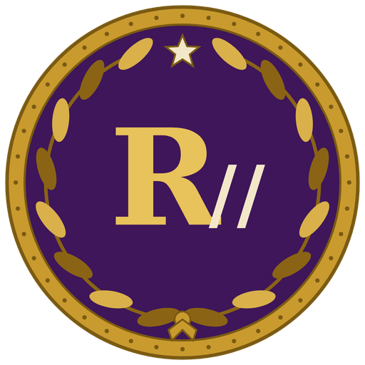

<h1 align="center">Roads of Empire</h1>

Tarih temalı, Monopoly tarzı bir tahta oyunu. Tarayıcıda oynanır, kurulum gerektirmez.

İmparatorlukların ticaret yollarında şehirler al, ülkeleri birleştir, çatılar kur ve rakiplerini iflas ettir.

## Oyna

👉 **[Tarayıcıda oyna](https://cakirmusti.github.io/roads-of-empire/)**

Ya da `index.html` dosyasını indirip çift tıkla. İnternet bağlantısı gerekmez.

## Özellikler

- 32 karelik tahta: 8 ülke, 4 liman, Şans kareleri, Sürgün, Kervansaray ve Kâşif
- 2–4 oyuncu, istenen oyuncuyu bilgisayar oynayabilir (Kolay, Orta, Zor)
- 14 farklı 3D piyon
- Ülke ve çatı formlama: Rus İmparatorluğu, Japonya, İberya, Asya'nın Efendileri, Angevin, Mare Mercatorum ve Roma, harita ve bayrak animasyonlarıyla
- Merchants' Center: dört limanın hepsine sahip olunca ticaret merkezi
- 54 tarihî Şans kartı, saklanabilen kartlar, savaş tazminatı ve isyan kartları
- Oyuncular arası takas: şehir, para ve saklanan kartlar
- Borç ekranı: kule, kale ve şehir satarak borcunu öde; botların borç satışları da ekranda görünür
- Kağıt para animasyonları: kira ödemesi kiracıdan kareye, oradan mülk sahibine gider
- Mülke göre vergi ve tarihî bayraklarla kutlama ekranları
- Para birimi: Rotum (R//) ve Venedik Dukatı

## Nasıl yapıldı

Roads of Empire'ı ben tasarladım. Oyunun kodunu Anthropic'in yapay zekâsı **Claude** ile birlikte yazdım.

**Benim yaptıklarım:** oyun fikri, tahta düzeni, şehir ve ülke seçimleri, bütün kira ve fiyat dengesi, çatı sistemi, Şans kartlarının seçimi, tasarım eskizleri, 3D piyon ve sikke modelleri, tarih araştırması ve oyun testleri.

**Claude'un yaptıkları:** kodun büyük kısmı, harita animasyonları ve kart illüstrasyonları.

## Sürümler

- **1.3 Görsellik** — Rus İmparatorluğu, Japonya, Asya'nın Efendileri, Angevin ve İberya için yeni formlama haritaları ve bayraklar; yeni tapu kartları (kule ve kale fiyatlarıyla); yeni kule, kale ve kare simgeleri; kağıt para ve kira ödeme animasyonu; botların borç satış ekranı; logo tahtanın ortasında; sade butonlar ve sadece Boşluk kısayolu; tapu kartı açılış ve kapanış animasyonu; masadaki tapuların koltuklara sığması; takas limiti kalktı, botlar ilk 5 tur takas yapmaz; Zar at butonunun tıklanmaması düzeltildi; sosyal medya önizleme görseli
- **1.2 Takas** — oyuncular arası takas (ilk 5 tur kapalı, sadece zar atmadan önce) ve takas yapan botlar; borç ekranı (kule ve kale %70'ine, şehir yarı fiyatına satılır); mülk değerinin %10'u kadar vergi (en az 50, en çok 1.000, tapusuz oyuncu ödemez) ve yeni vergi kartı; Şans destesi 54 karta çıktı (Panayır, Ahi misafirliği, Savaş tazminatı, İsyan ve saklanabilen kartlar); iflas ekranı; Kâşif yolculuğu animasyonu, Başlangıç bonusu ve yeni kısıtları; zar atılınca varış yerinin görünmesi; daha koyu kira bantları; yeni tapu kartları; Roma İmparatorluğu adı ve net bayraklar
- **1.1** — dar pencerede piyon seçimi ve tapular düzeldi; başlangıç parası 1.500, Başlangıç bonusu 150; akıllı bilgisayar oyuncuları ve zorluk seviyeleri; Merchants' Center; karelerde fiyat/kira bandı; oyuncu rengi seçimi; formlamada kira artış listesi; Japonya'nın rengi pembe; Rio de Janeiro
- **1.0** — ilk sürüm

## Kaynaklar

- Harita verisi: [Natural Earth](https://www.naturalearthdata.com/) / [world-atlas](https://github.com/topojson/world-atlas)
- Yazı tipi: DejaVu Serif
